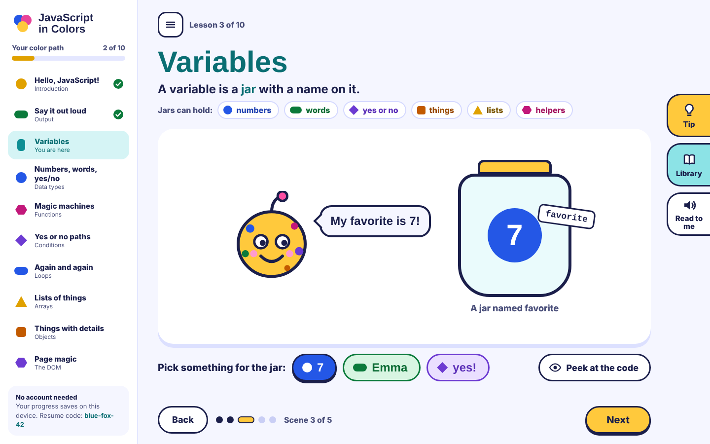

# JavaScript in Colors

A web app that introduces young children (about 6 to 12) to JavaScript **ideas** through color, shape, short reading and tiny interactions. There is almost no typing of code. Every concept has its own color, shape and word: numbers are blue circles, words are green pills, yes-or-no is a purple diamond, and a variable is a jar with a name on it.

It is also a front-end portfolio project: modern Angular, a real design system, accessibility, animation and tests, built with Claude Code.



> Status: all ten lessons (Hello, Say it out loud, Variables, Numbers, words, yes/no, Magic machines, Yes or no paths, Again and again, Lists of things, Things with details, and Page magic) run on a data-driven lesson engine. Home shows the color path with a Continue button, and progress, a resume code, Calm motion and Text size are saved on the device. The chat and the certificate come next. Progress so far: [docs/build-log.md](docs/build-log.md).

## Stack

| Area              | Choice                                                                                                                                       |
| ----------------- | -------------------------------------------------------------------------------------------------------------------------------------------- |
| App               | Angular 22 (standalone components, signals, zoneless, new control flow, lazy routes)                                                         |
| Monorepo          | Nx 24                                                                                                                                        |
| Styling           | SCSS, ITCSS-lite layers, CSS custom-property design tokens, light / dark / high-contrast themes                                              |
| Fonts             | Baloo 2 + Nunito, self-hosted (OFL)                                                                                                          |
| State             | Signals for local state; NgRx SignalStore for features; classic NgRx for cross-cutting state ([ADR 0002](docs/adr/0002-state-management.md)) |
| Data (planned)    | GraphQL (Apollo Angular + graphql-codegen), mocked with MSW ([ADR 0003](docs/adr/0003-minimal-backend.md))                                   |
| Visuals (planned) | D3 modules for SVG concept visuals                                                                                                           |
| Unit tests        | Vitest (Angular's `@angular/build:unit-test` for the app, AnalogJS for libs)                                                                 |
| Component docs    | Storybook 10 with the a11y addon                                                                                                             |
| E2E               | Cypress 15 + cypress-axe at three viewports                                                                                                  |
| CI                | GitHub Actions                                                                                                                               |

## Repo layout

```
apps/web            Angular app (shell, Home, lesson route)
apps/web-e2e        Cypress smoke + accessibility tests
libs/ui             Design-system components (each has a Storybook story)
libs/lesson-engine  Renders lessons from data (scene-type registry)
libs/data-access    Course and lesson SignalStores, saved progress, settings store (GraphQL later)
libs/visuals        Lesson pictures: jar, screen, Dot, machine, fork, list, card, page
libs/shared         Concepts, lesson types, content validator
content/            Lessons as YAML (see content/README.md)
tools/content       Content build: validate YAML, compile to typed modules
styles/             Design tokens and global SCSS layers
docs/mockups        The visual source of truth
docs/adr            Architecture decision records
```

## Run it

Requires Node 24 (see `.nvmrc`).

```bash
npm ci
npm start                      # http://localhost:4200
npx nx storybook ui            # http://localhost:4400
npx nx run-many -t lint test build
npx nx e2e web-e2e             # Cypress smoke + axe (starts the app for you)
```

The full command list is in [CLAUDE.md](CLAUDE.md#commands).

## Privacy by design

The learners are children, so the rules are strict ([ADR 0001](docs/adr/0001-anonymous-first-local-first-progress.md)):

- No account and no login. Progress stays in the browser, under a random resume code such as `blue-fox-42` that says nothing about the child ([ADR 0008](docs/adr/0008-local-progress-and-settings.md)).
- No personal data, no analytics, no tracking, no third-party scripts or CDN assets.
- The certificate name is typed and rendered on the device and never sent anywhere.
- Chat (later) runs through a server-side proxy, is never stored, and answers only about JavaScript.

## Accessibility and performance

Built to WCAG 2.2 AA. Every interaction works with the keyboard, color is never the only signal (each concept has a shape and a word), every animation has a calm alternative, touch targets are 44px or more, and the layout works from 320px wide and at 200% text size.

| Check                                                                                  | Result                                                                                                |
| -------------------------------------------------------------------------------------- | ----------------------------------------------------------------------------------------------------- |
| cypress-axe (WCAG 2.x A/AA), phone / tablet / desktop, Tip and Library open and closed | 0 violations                                                                                          |
| cypress-axe on every scene of Variables, keyboard only, phone and desktop              | 0 violations                                                                                          |
| cypress-axe in the dark and high-contrast themes                                       | 0 violations                                                                                          |
| cypress-axe on Home, phone / tablet / desktop, all three themes                        | 0 violations                                                                                          |
| Blocked or broken browser storage (e2e)                                                | The app still works; progress lasts for the visit                                                     |
| prefers-reduced-motion (emulated in the browser), or the Calm motion setting           | No animations run; final states shown at once                                                         |
| Storybook a11y addon                                                                   | Runs on every story (`test: 'error'`)                                                                 |
| Lighthouse performance (mobile)                                                        | _to be measured_                                                                                      |
| Lighthouse accessibility                                                               | _to be measured_                                                                                      |
| Initial JS + CSS (production build)                                                    | 324 kB raw, 88 kB gzipped (Home, the lesson page and each lesson are lazy); the build fails at 400 kB |

## How I built this with Claude Code

_Placeholder: a short write-up will go here. The raw notes are in [docs/build-log.md](docs/build-log.md): plan mode before each task, small commits, ADRs, the mockups as the source of truth, and where tests and human judgment caught problems._

## License

- **Code:** [MIT](LICENSE).
- **Content and artwork** (lesson text, Dot and other illustrations, mockups): [CC BY-NC 4.0](LICENSE-CONTENT.md).
- **Fonts:** SIL Open Font License 1.1 (Baloo 2, Nunito).

See [ADR 0006](docs/adr/0006-licensing.md) for what falls under which license.
